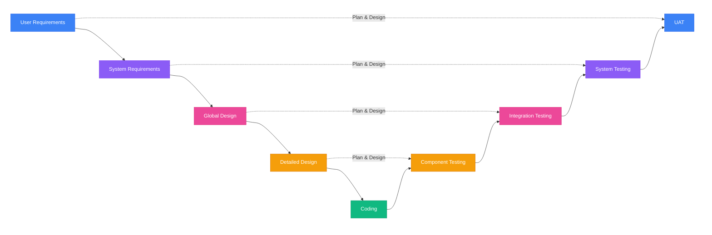
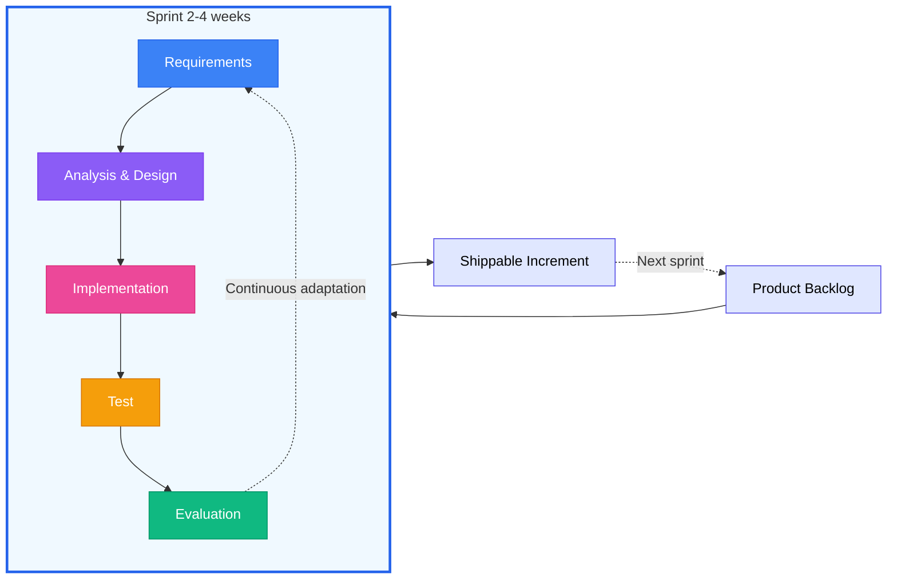

# Synthesis

## Introduction and Objectives of Test Automation

This chapter introduces test automation and why it exists, through three learning objectives:

- TAE-1.1.1 — Explain the Advantages and Disadvantages of Test Automation
  *What automation is (setup, execute, compare), what it gains, what it costs, and where it stops*
- TAE-1.2.1 — Explain How Test Automation Is Applied Across SDLC Models
  *How Waterfall, V-Model, and Agile change when automation starts, how it runs, and what that implies*
- TAE-1.2.2 — Select Suitable Test Automation Tools for a Given SUT
  *How to choose tools from SUT, project needs, and team skills, then validate with comparison and pilots*

### Keywords

| Term | Definition |
| --- | --- |
| **System Under Test** *(SUT)* | A type of test object that is a system. |
| **Test Automation** | The use of software to perform or support test activities (e.g. test management, test design, test execution and results checking). |
| **Test Automation Engineer** *(TAE)* | A person who is responsible for the design, implementation and maintenance of a test automation architecture as well as the technical evolution of the resulting test automation solution. |

Sequence: understand what automation can and cannot do (1.1.1), place it in the development lifecycle (1.2.1), then select tools that fit the SUT and the team (1.2.2).

## TAE-1.1.1 (K2) : Explain the Advantages and Disadvantages of Test Automation

Test automation uses specialised software to:

1. Control and set up test suites for execution
2. Run tests without manual steps
3. Compare actual results with expected results

It can interact with many kinds of SUT (UI and non-UI, mobile, network protocols, etc.). A TAE designs, builds, and maintains the TAS (Test Automation Solution).

### Advantages

| Advantage | Idea |
| --- | --- |
| More tests per build | Higher volume than manual runs |
| Tests that cannot be done manually | Real-time response checks, remote runs, parallel or multi-device load |
| More complex scenarios | Multi-system flows that are hard to repeat by hand |
| Speed | Faster execution than a human |
| Fewer human execution errors | Same steps every time |
| Better use of test resources | Efficiency over repeated cycles |
| Faster quality feedback | Earlier signal on SUT quality |
| Consistency | Same behaviour across cycles; supports reliability goals (e.g. availability, recovery) |

### Disadvantages

| Disadvantage | Idea |
| --- | --- |
| Extra project cost | TAE effort, hardware, tools, training |
| Initial investment | Time and money before value appears |
| Build and maintain the solution | Scripts and frameworks must evolve with the SUT |
| Need clear automation goals | Without them, success is unlikely |
| Rigidity | Small SUT changes can break tests |
| New defects from automation itself | Bugs in scripts cause false positives or negatives |

### Limitations

Keep these limits in mind:

1. Not every manual test can be automated (e.g. UX judgement)
2. Automation only checks what it is programmed to check
3. It can only verify machine-interpretable results; some quality characteristics stay out of reach
4. An automated test oracle is required; hard when many answers are valid or data changes in real time (e.g. flight availability)

### Conclusion

1. Automation amplifies volume, speed, and consistency, and enables tests humans cannot run.
2. It costs upfront, needs maintenance, and can be brittle or wrong if scripts are buggy.
3. Balance automated and manual testing: automation handles repetition; humans keep exploratory and judgement work.

## TAE-1.2.1 (K2) : Explain How Test Automation Is Applied Across SDLC Models

Automation timing and strategy depend on the SDLC (Software Development Life Cycle). There is no single approach that fits every model.

### Waterfall

Waterfall is linear and sequential: each phase is completed before the next starts, and usually ends with approved documentation.

| Phase | What happens |
| --- | --- |
| Requirements | Collect and analyze what the system must do |
| Design | Define the detailed system design |
| Implementation | Build the software |
| Verification | Test and validate against the requirements |
| Maintenance | Fix defects and make improvements |

- **Implementation of automation:** in parallel with or after Implementation
- **Execution:** mainly in Verification, when software is ready to test

Automation comes late (the system must be built before it can be tested), so feedback arrives late. Major defects found in Verification force costly returns to earlier phases.

| Pros | Cons |
| --- | --- |
| Stable requirements support building thorough automation | Late feedback makes fixes expensive |
| Rich documentation helps detailed test design | Rigid structure; hard to update code and tests once phases are closed |

**Example:** tax-processing system. Automation could start only around month four; runs came in large chunks during Verification; every phase needed formal sign-off.

### V-Model

Sequential development on the left of the V, matching test levels on the right. Traditional levels: component, component integration, system, system integration, acceptance. A TAF per test level is possible and recommended. Test planning and design start with each development phase; execution rises through the levels after coding.

| Pros | Cons |
| --- | --- |
| Earlier defect detection than pure late testing | More upfront planning to keep development and tests aligned |
| Clear mapping between development phases and test levels | Risk of redundant automation across levels |

**Example:** medical device. Four automation setups: automated unit, integration, and system tests, plus semi-automated acceptance for regulatory compliance.

### Agile

Short iterations (sprints). TAEs and business representatives can set roadmap and schedule. Practices such as code review, pair programming, and frequent automated runs support quality. Breaking silos lets the team cover levels with the right amount of automation and aim for **in-sprint automation**.

| Pros | Cons |
| --- | --- |
| Fast feedback and continuous runs | Frequent SUT change raises maintenance |
| Flexible framework that can follow changing requirements | Needs programming skill and enough capacity |
| Shared quality ownership across roles | — |

**Example:** e-commerce. Developers write unit tests with the code; TAEs add UI tests for new features; nightly automated runs; fixes each morning; multiple production deploys per day become possible.

### Comparison

| Model | When automation is built | When it runs | Typical character |
| --- | --- | --- | --- |
| Waterfall | During/after Implementation | Verification | Late feedback, heavy docs, costly change |
| V-Model | Planned from each design phase | Per test level | Multi-level TAF, structured coverage |
| Agile | Inside each sprint | Continuous (e.g. CI/CD) | Fast feedback, collaboration, maintenance pressure |

### Conclusion

1. Match automation strategy to the SDLC constraints (sequential vs iterative, rigid vs flexible).
2. Timing of build and run drives how early defects appear and how expensive fixes are.
3. Implement automation deliberately for the model, not by default the same way everywhere.

## TAE-1.2.2 (K2) : Select Suitable Test Automation Tools for a Given SUT

Analyze the SUT and project needs before picking tools. UI tools and web-service tools differ. There is no fixed limit on how many tools or features you may use, but cost always matters. Options include commercial off-the-shelf products and custom solutions on open-source technology. Team skill matters as much as technical fit.

### Step 1: Analyze context

#### Existing (SUT) - what already exists

So tool choice fits the real system, not an assumed one:

| Analyze | Examples | Used to |
| --- | --- | --- |
| Nature of the system | Web UI, REST API, desktop, web services | Identify the tool category needed |
| Platforms to cover | Web, iOS, Android, Windows, Linux, macOS | Know which environments the tool must support |
| Technologies | Java, React, Python, .NET, Angular | Check compatibility and language fit |
| Architecture | Monolith, microservices, hybrid | Shape the tooling approach and strategy (e.g. one suite vs specialized tools per service) |

#### Expectations (Project) - what we want to achieve

| Analyze | Examples | Used to |
| --- | --- | --- |
| Test types needed | UI, API, performance, security, integration | Identify which kinds of tools are required |
| Expected coverage | 50% of tests, smoke only, full regression | Estimate effort and complexity |
| Timeline | 3 months, 1 year, aggressive time-to-market | Judge how much learning curve is acceptable |
| Budget | Open source (€0), mid-range license, high license cost | Steer toward commercial or open source |
| Regulatory constraints | HIPAA, GDPR, ISO 26262 | Spot certification and traceability needs |

**Example:** healthcare project needing web and mobile, complex calculations, HIPAA compliance, and third-party integrations. The team used several specialised tools: Selenium (web UI), Appium (mobile), Postman (API), and custom scripts for calculation checks.

#### Capabilities (Team) - what we are able to do

| Analyze | Examples | Used to |
| --- | --- | --- |
| Technical level | Beginner (GUI needed), intermediate, expert (complex scripts) | Steer toward tools that match team skill |
| Languages mastered | Java, Python, JavaScript, C#, none (manual testers) | Limit training time and maximize who can contribute |

**Managing technical level**

- Low technical level → prefer low-code / no-code, GUI, record-and-playback, little code to write
- High technical level → prefer tools aligned with the application language, with good API documentation and an extensible framework

**Language alignment**

Matching the tool language to the SUT helps developers debug automation defects with testers, shortens fix time, and improves collaboration.

Examples: Java → JUnit/TestNG; JavaScript → Cypress/Playwright; Python → pytest/Robot Framework.

**Example:** startup QA team chose TestCafé for a gentle learning curve, record-and-playback, optional custom code, and clear docs. Cypress and Playwright were strong options but better suited to more technical teams; TestCafé fitted this team's context.

### Step 2: Evaluate options

| Type | Meaning | Strength | Trade-off |
| --- | --- | --- | --- |
| Commercial (COTS) | Off-the-shelf product you buy | Ready-made, vendor support | Licence cost |
| Open source | Free community-driven software | No licence fee | Integration and maintenance on the team |
| Custom | Built in-house for the project | Fits specific needs | Long to build; needs expertise |

Practical evaluation:

1. Build a comparison matrix (requirements as rows, candidate tools as columns)
2. Run a short pilot on 2–3 finalists; collect team feedback; check maintenance load

For open source: community activity, last release, open issues, documentation quality.
For commercial: extended trial, training quotes, support response times, licence model.

### Step 3: Decide without common traps

1. **Swiss-army-knife trap:** one tool that claims to do everything often does each part worse than specialised tools
2. **Following the crowd:** popularity is not a substitute for fit to SUT and team
3. **Budget blinders:** cheapest licence can be the highest total cost; include training and maintenance (TCO)

### Conclusion

1. Start from SUT, project goals, and team skills, not from a favourite tool.
2. Compare candidates on a matrix, then prove fit with a pilot.
3. Prefer a coherent set of specialised tools when needed, and account for full cost of ownership.

## Chapter wrap-up

1. Know automation’s gains, costs, and hard limits before investing.
2. Adapt when and how you automate to Waterfall, V-Model, or Agile.
3. Select tools from context analysis, team capability, structured comparison, and pilots.
